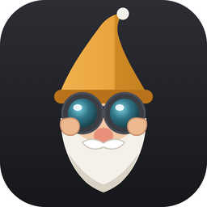
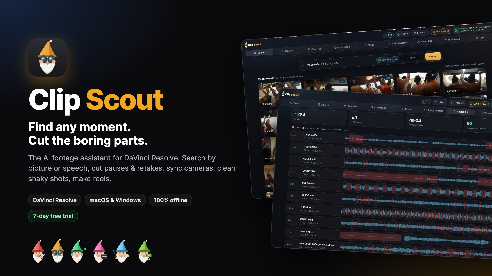
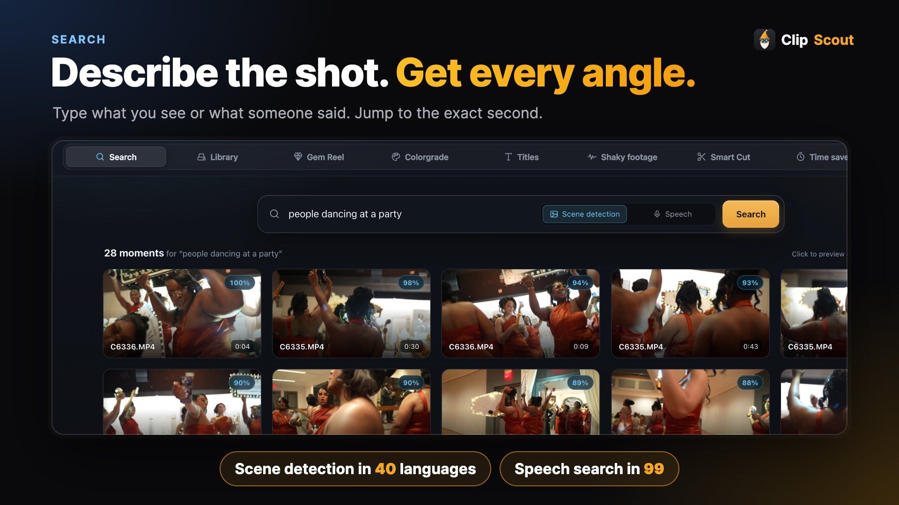
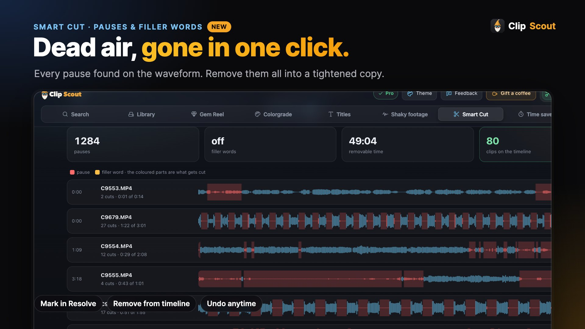
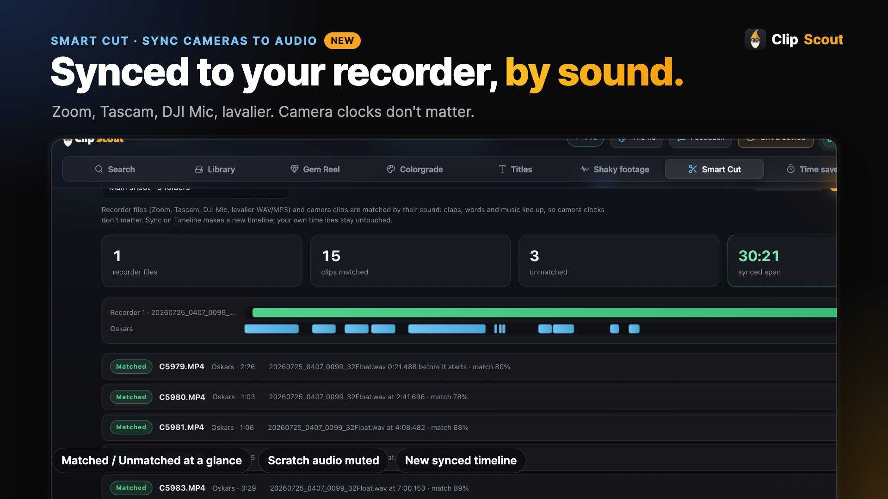
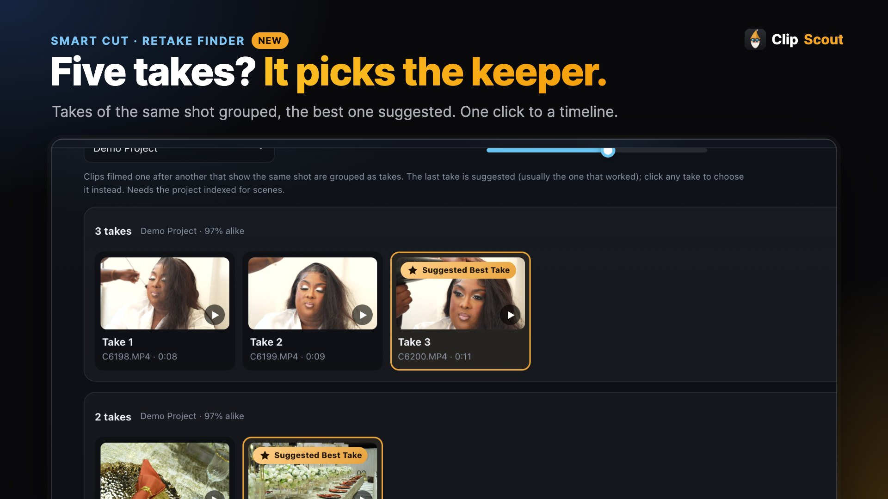
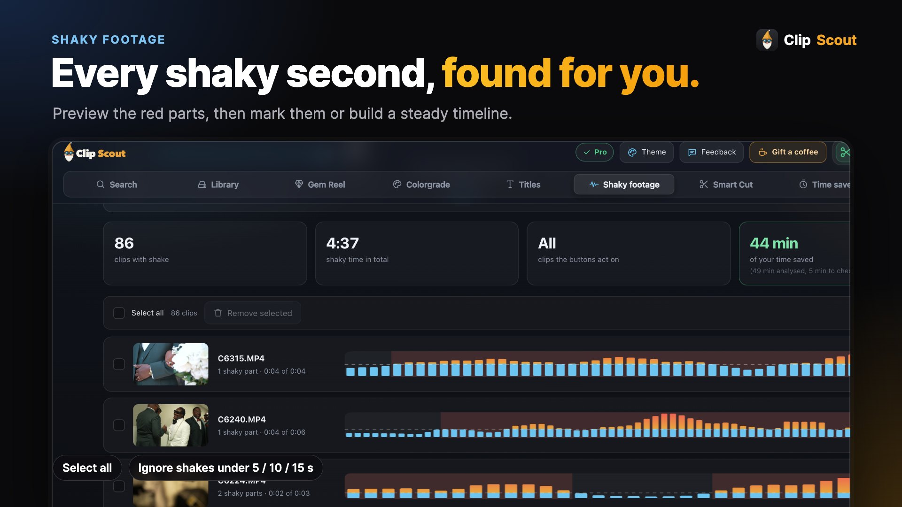
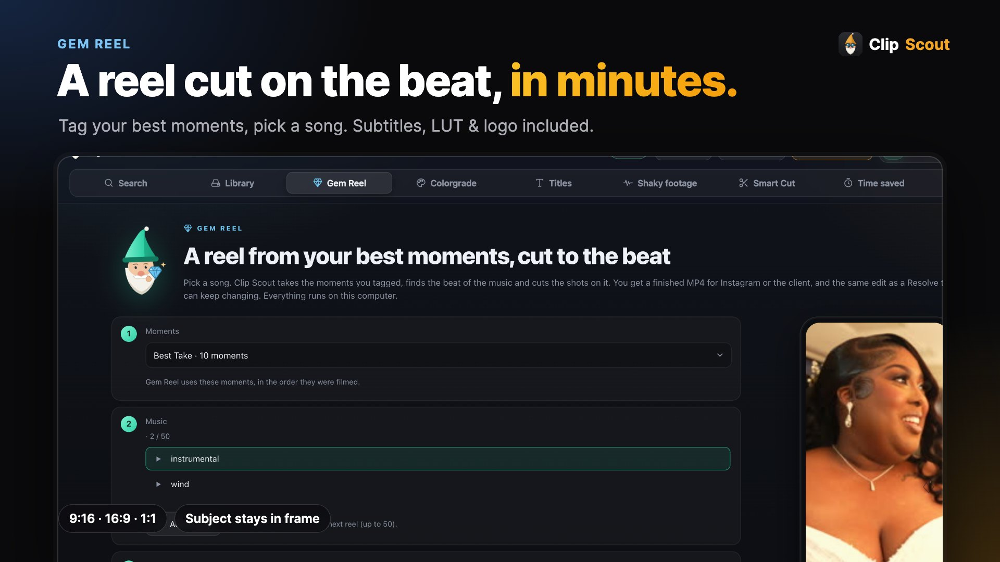
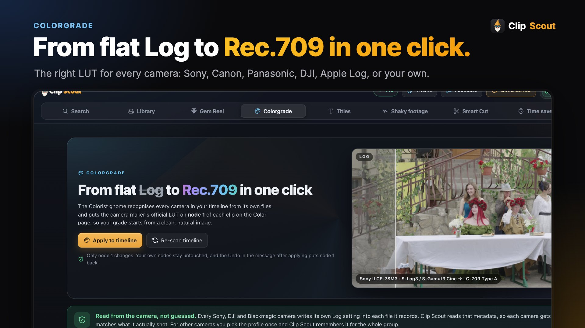

  

<h1 align="center">Clip Scout for DaVinci Resolve</h1>

  <b>Find any moment. Cut the boring parts.</b> 
  The offline AI footage assistant for DaVinci Resolve.

  
  
  
  
  

  <a href="https://github.com/Clip-Scout/clip-scout-davinci-resolve/releases/latest"><b>Download the 7-day free trial</b></a> ·
  <a href="https://payhip.com/b/EpcLO"><b>Buy Clip Scout</b></a> ·
  <a href="https://clip-scout-pied.vercel.app">Website</a> ·
  <a href="https://www.paypal.com/donate/?business=oskarsfiverr%40gmail.com&item_name=Gift+a+coffee+for+Clip+Scout&currency_code=EUR&no_recurring=0">☕ Buy me a coffee</a>

Clip Scout watches and listens to every clip once, so you never scrub through hours of footage again. Search by what's in the picture or what people said, cut pauses and retakes, sync cameras to your audio recorder, clean up shaky shots, grade Log footage and make beat-synced reels, all next to DaVinci Resolve and all on your own computer.

> This repository holds the **installers, release notes and install guides**. Clip Scout is commercial software; its source code is not public.

## Download

| | macOS | Windows |
|---|---|---|
| **Installer** | [`ClipScout-1.1.0-Mac.pkg`](https://github.com/Clip-Scout/clip-scout-davinci-resolve/releases/latest) | [`ClipScout-1.1.0-Windows.exe`](https://github.com/Clip-Scout/clip-scout-davinci-resolve/releases/latest) |
| **Needs** | Apple silicon (M1 or newer), macOS 12+ | Windows 10/11, 64-bit |

Every download starts as a **7-day free trial**: no card, no account. To unlock the full version, [buy a licence on Payhip](https://payhip.com/b/EpcLO), click **Trial** at the top of Clip Scout and paste your key. Your scanned projects are kept; there is nothing to reinstall.

Checksums for every file are in `SHA256SUMS.txt` on each release.

## What it does

### Search your footage like a library
Type what you see (*"drone over the river"*, *"people dancing"*) or a line someone said, in your own language. Clip Scout jumps to the exact second in any clip, across every camera, and drops the results onto a Resolve timeline.

### Smart Cut new in 1.1
- **Pauses and filler words:** every pause on your timeline is shown on the waveform. Mark them in Resolve or remove them all into a tightened copy.
- **Sync cameras to your recorder:** Zoom, Tascam, DJI Mic or lavalier, matched by their sound, so camera clocks don't matter. Only confident matches are placed.
- **Retake finder:** takes of the same shot are grouped, the best one suggested, and one click builds the timeline from your picks.

### Shaky footage, found for you
See exactly which seconds of each clip are shaky, preview them, then mark them or build a steady timeline in one click. Nothing is ever deleted from your drive.

### Gem Reel
Tag your best moments and pick a song: Clip Scout cuts them on the beat into a 9:16, 16:9 or 1:1 reel that keeps the subject in frame, with subtitles, your LUT and your logo. You get an MP4 and an editable Resolve timeline.

### Log to Rec.709 in one click
Clip Scout reads which camera shot each clip (Sony, Canon, Panasonic, Blackmagic, DJI, Apple Log) and puts the right conversion LUT on every one, or your own favourite LUTs.

## Why editors use it

- **100% offline.** No uploads, no cloud, no account. Your clients' footage never leaves your computer.
- **Pay once.** No subscription. Updates are included, and Clip Scout tells you inside the app when a new version is ready.
- **Safe on real projects.** Clip Scout never overwrites your timelines; it makes new ones, and every change it makes in Resolve can be undone with one click.

## Install

**macOS**
1. Download `ClipScout-1.1.0-Mac.pkg` and double-click it.
2. If macOS says it can't check the installer: right-click it, choose **Open**, then **Open** again (or allow it in *System Settings → Privacy & Security*).
3. Click through the installer. Keep the internet on for a few minutes afterwards while the AI models download once (about 2 GB).

**Windows**
1. Download `ClipScout-1.1.0-Windows.exe` and double-click it.
2. If SmartScreen appears: click **More info → Run anyway**.
3. Click through the installer. It downloads the AI models once (about 2 GB).

**Then, in DaVinci Resolve**
1. Restart Resolve.
2. *Preferences → System → General → External scripting using: **Local*** (so Clip Scout can add markers, timelines and LUTs).
3. Open Clip Scout from **Workspace → Scripts → Utility → Clip Scout**. In DaVinci Resolve Studio you can also dock it: **Workspace → Workflow Integrations → Clip Scout**.

Sending results into Resolve (markers, timelines, LUTs) uses Resolve's external scripting, which Blackmagic includes in **DaVinci Resolve Studio**. Try the free trial with your setup before buying.

## Updating

Clip Scout checks for new versions and shows **"Clip Scout x.y is ready"** with the list of changes. **Update now** downloads the new installer, checks it isn't damaged, and opens it. Your licence, settings and scanned projects stay.

All versions: [Releases](https://github.com/Clip-Scout/clip-scout-davinci-resolve/releases) · [Changelog](CHANGELOG.md)

## Questions

<b>Does my footage get uploaded anywhere?</b>

No. Everything runs on your computer. The only downloads are the AI models (once, right after installing) and the small update notice. Clip Scout works with the internet switched off.

<b>Does it work with the free DaVinci Resolve?</b>

Scanning, search, Smart Cut analysis, shaky detection and reels run in Clip Scout itself. Sending results into Resolve (markers, timelines, LUTs, the docked panel) needs DaVinci Resolve Studio.

<b>What's locked in the trial?</b>

For 7 days everything works except two finishing actions: one-click Remove shaky parts and applying LUTs in Resolve. A licence key unlocks both.

<b>Intel Mac or Linux?</b>

Not at the moment: macOS on Apple silicon and Windows 10/11 (64-bit).

<b>Where do I get help?</b>

Use <b>Feedback</b> inside Clip Scout, or the contact details on <a href="https://oskvid.com">oskvid.com</a>.

## Support the project

Clip Scout is made by one editor. If it saves you time, you can [**☕ buy me a coffee**](https://www.paypal.com/donate/?business=oskarsfiverr%40gmail.com&item_name=Gift+a+coffee+for+Clip+Scout&currency_code=EUR&no_recurring=0). Thank you!

## Licence

Clip Scout is proprietary software, © 2026 Oskars Andersons. All rights reserved. Use is governed by the [End User Licence Agreement](LICENSE.txt). Open-source components and their licences are listed in [THIRD_PARTY_NOTICES.txt](THIRD_PARTY_NOTICES.txt).

DaVinci Resolve is a trademark of Blackmagic Design Pty Ltd. Clip Scout is not affiliated with Blackmagic Design.

Crafted by <a href="https://oskvid.com">Oskars Andersons</a> · <a href="https://payhip.com/ClipScoutC">More products</a>

